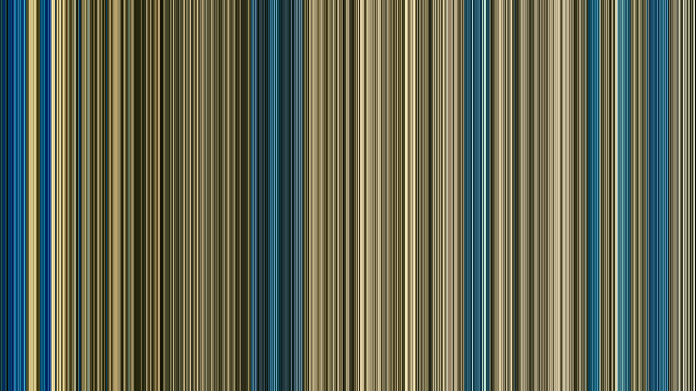
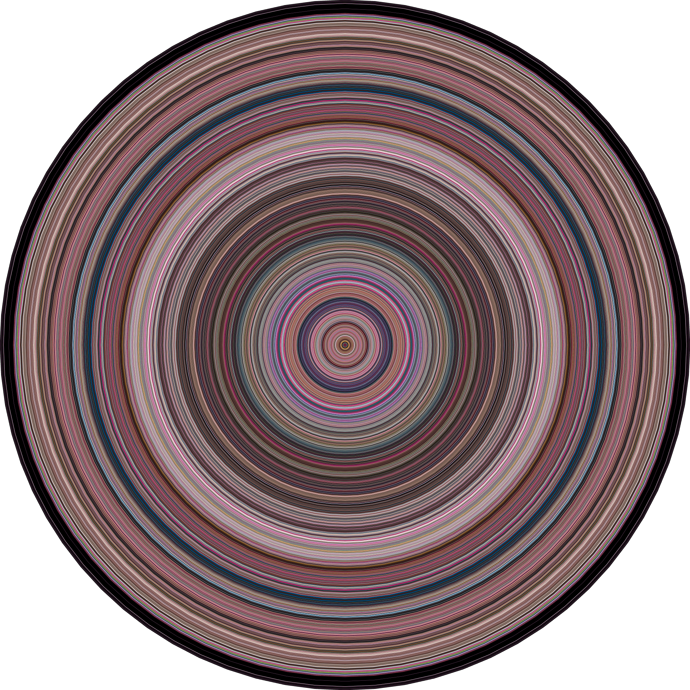
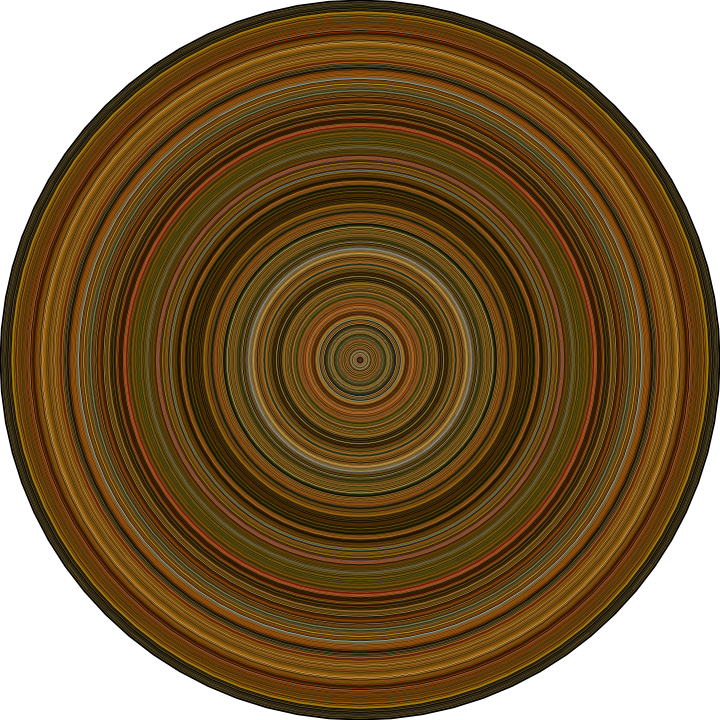
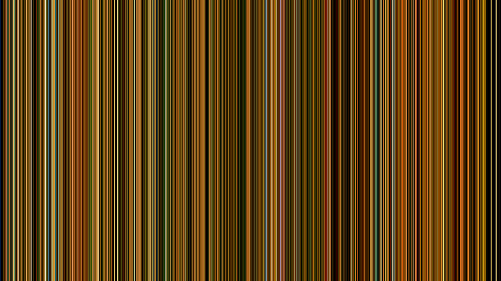
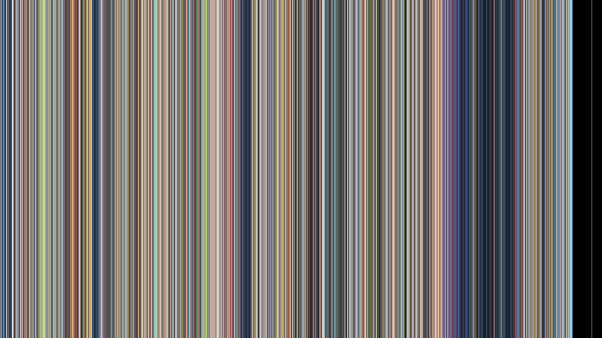
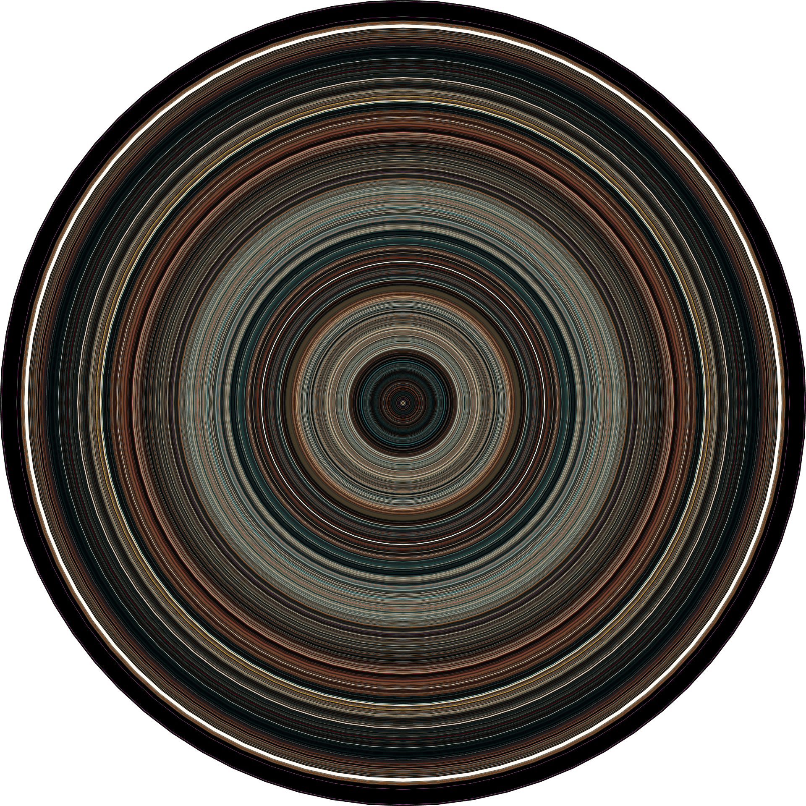
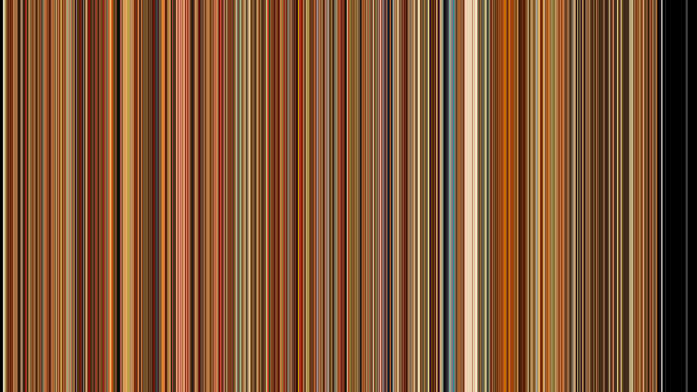

# Movie Barcodes
The Lodger: A Story of the London Fog (1927) - Alfred Hitchcock - [Public Domain](https://archive.org/details/TheLodgerAStoryOfTheLondonFog_579)

Circular Barcode           |  Horizontal Barcode
:-------------------------:|:-------------------------:
  |  


# Overview

Compress every frame of a movie in a single color barcode.

This project is a robust and highly configurable utility designed to extract dominant colors from video files and generate color barcodes. Built with Python and OpenCV, the tool offers multiple algorithms for color extraction, including average color, K-means clustering, and HSV/BGR histograms. The output can be generated in various forms, like horizontal and circular barcodes, providing a visually intuitive summary of the color distribution in the video.

Designed with performance in mind, the application supports both sequential and parallel processing. It scales automatically based on the available CPU cores but can be fine-tuned for a specified number of workers. This makes it suitable for analyzing both short clips and full-length movies with high efficiency.

# Features
- Horizontal and Circular Barcodes
- Fast frame skipping for efficiency.
- Supports `.mp4`, `.webm` & `.mkv` files
- Multiprocessing support for parallel processing.
- Customizable color extraction function (Average or K-means).
- Progress tracking and estimated time remaining.

# Usage
```bash
# Install the package
$ pip install movie-barcodes

# Generate a movie barcode
$ movie-barcodes -i "path/to/video.mp4"

# Arguments available
usage: movie-barcodes [-h] -i INPUT_VIDEO_PATH [-d [DESTINATION_PATH]] [-t {horizontal,circular}] [-m {avg,kmeans,hsv,bgr,smoothed}] [-w WORKERS] [--width WIDTH] [--height HEIGHT] [-n [OUTPUT_NAME]] [-a] [--crop-borders] [--linear]
```

***Mandatory Arguments:***
- `-i`, `--input_video_path`: The path to the input video file. (Required, type: str)

***Optional Arguments:***
- `-d`, `--destination_path`: The path where the output image will be saved. If not provided, defaults to a pre-defined location. (Optional, type: str)

- `-t`, `--barcode_type`: The type of barcode to generate. Options are horizontal or circular. Default is horizontal. (Optional, type: str)

- `-m`, `--method`: The algorithm for extracting the dominant color from frames. Options are avg (average), kmeans (K-Means clustering), hsv (HSV histogram), bgr (BGR histogram) and smoothed versions. Default is avg. (Optional, type: str)

- `-w`, `--workers`: Number of parallel workers for processing. By default, the script will use all available CPU cores. Setting this to 1 will use sequential processing. Values above the number of available CPU cores are capped to that number, with a warning. (Optional, type: int)

- `--width`: The number of sampled frames. For horizontal barcodes it is also the output image width in pixels; for circular barcodes it is the number of rings. If not specified, defaults to the input video width (capped by the number of frames). Must not exceed the number of frames. (Optional, type: int)

- `--height`: The output image's height in pixels. If not specified, the height will be the same as the input video. (Optional, type: int)

- `-n`, `--output_name`: Custom name for the output barcode image. If not provided, a name will be automatically generated. (Optional, type: str)

- `-a`, `--all_methods`: If set, all extraction methods will be run. This overrides `--method` and produces one image per method. Default is False. (Optional, type: bool)

- `--crop-borders`: If set, black borders (letterbox bars on a 2.39:1 movie encoded in 16:9, or pillarbox bars on the sides) are detected once, from about 25 frames spread over the movie, and ignored when extracting colors, so they no longer darken the barcode. The output image size is unchanged. Default is False. (Optional, type: bool)

- `--linear`: If set, the `avg` and `smoothed` methods average colors in linear light instead of averaging the gamma encoded sRGB values: pixels are decoded with the sRGB transfer function, averaged, then encoded back. This is the perceptually correct mix, brighter on high-contrast scenes: a frame half black and half white gives a gray of 188 instead of 128. It also applies to `avg` and `smoothed` when used with `-a`. The other methods (`kmeans`, `hsv`, `bgr`) are unaffected. The barcodes get a `_linear` suffix after the method name (e.g. `video_avg_linear_horizontal.png`), so they don't overwrite the default ones. Default is False. (Optional, type: bool)

Notes:
- Circular barcode sizing: the circular barcode diameter is the input video width. `--height` does not apply to circular barcodes.
- Destination paths:
  - Without `-d`, the image is saved in a `barcodes/` folder in the current working directory.
  - A relative `-d` path is resolved relative to the current working directory.
  - Parent directories are created automatically when saving the image.
- The `hsv` method falls back to the frame's mean color when a frame has almost no colorful pixels (black, white or gray frames).

# Examples
## Sequential Processing
```python
python -m movie_barcodes -i "path/to/video" --width 200 -w 1
```
## Parallel Processing
```python
python -m movie_barcodes -i "path/to/video" --width 200 -w 8
```

# Development Setup
```bash
# Clone this repository
$ git clone https://github.com/Wazzabeee/movie-barcodes

# Go into the repository
$ cd movie-barcodes

# Install uv (see uv docs for other OSes)
$ curl -LsSf https://astral.sh/uv/install.sh | sh   # or: brew install uv

# Create .venv with the pinned Python (.python-version) and the exact locked versions (uv.lock),
# including dev tools (pytest, pre-commit) and the package itself in editable mode
$ uv sync

# Install pre-commit hooks
$ uv run pre-commit install

# Run tests
$ uv run pytest tests/

# Run package locally
$ uv run python -m movie_barcodes -i "path_to_video.mp4"
```

# Todo

- [x] Optimize K-means to speed up the process
- [ ] Add a small GUI with all options available
- [x] Add option to modify the barcode's height (`--height`)
- [x] Ensure the software can handle various video formats beyond MP4 (`.webm`, `.mkv`)
- [ ] Allow the software to process multiple videos at once
- [ ] Develop POC on Hugging Face Space
- [x] Remove the logs creation when using package (logs go to stdout)

# More Examples
## Barbie (2023) - Greta Gerwig
```python
movie-barcodes -i "barbie.mp4" -t "circular" -m "smoothed"
movie-barcodes -i "barbie.mp4" --width 1920 --height 1080 -t "horizontal"
```
Circular Barcode           |  Horizontal Barcode
:-------------------------:|:-------------------------:
  |  
## Le Fabuleux Destin d'Amélie Poulain (2001) - Jean-Pierre Jeunet
```python
movie-barcodes -i "amelie.mp4" -t "circular" -m "smoothed"
movie-barcodes -i "amelie.mp4" --width 1920 --height 1080 -t "horizontal"
```
Circular Barcode           |  Horizontal Barcode
:-------------------------:|:-------------------------:
  |  
## Your Name / Kimi no Na wa / 君の名は (2016) - Makoto Shinkai
```python
movie-barcodes -i "Your Name.mp4" -t "circular" -m "smoothed"
movie-barcodes -i "Your Name.mp4" --width 1920 --height 1080 -t "horizontal"
```
Circular Barcode           |  Horizontal Barcode
:-------------------------:|:-------------------------:
  |  
## Drive (2011) - Nicolas Winding Refn
```python
movie-barcodes -i "Drive.mp4" -t "circular" -m "smoothed"
movie-barcodes -i "Drive.mp4" --width 1920 --height 1080 -t "horizontal"
```
Circular Barcode           |  Horizontal Barcode
:-------------------------:|:-------------------------:
  |  
## The Royal Tenenbaums (2001) - Wes Anderson
```python
movie-barcodes -i "royal_tenenbaums.mp4" -t "circular" -m "smoothed"
movie-barcodes -i "royal_tenenbaums.mp4" --width 1920 --height 1080 -t "horizontal"
```
Circular Barcode           |  Horizontal Barcode
:-------------------------:|:-------------------------:
  |  
