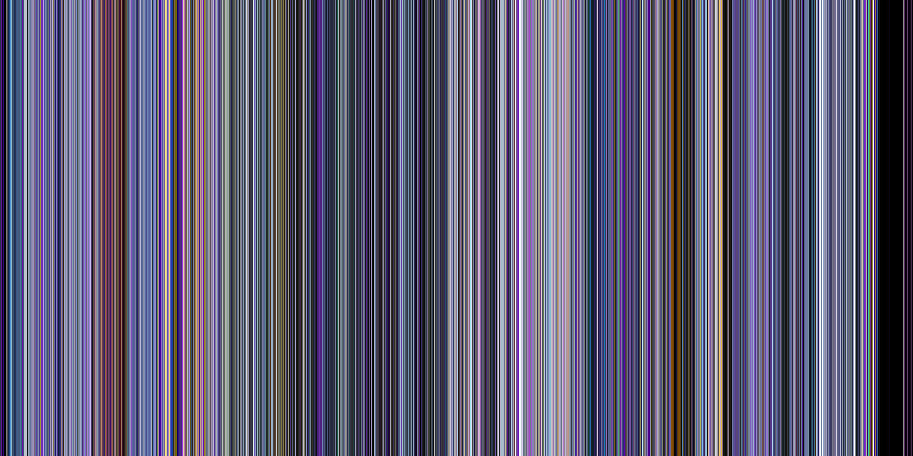
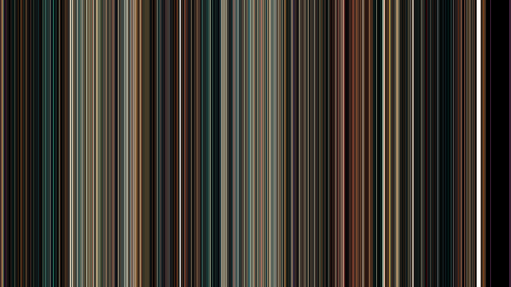

# Movie Barcodes
The Lodger: A Story of the London Fog (1927) - Alfred Hitchcock - [Public Domain](https://archive.org/details/TheLodgerAStoryOfTheLondonFog_579)

Circular Barcode           |  Horizontal Barcode
:-------------------------:|:-------------------------:
  |  


# Overview

Compress every frame of a movie in a single color barcode.

This project is a robust and highly configurable utility designed to extract dominant colors from video files and generate color barcodes. Built with Python and OpenCV, the tool offers multiple algorithms for color extraction, including average color, K-means clustering, and HSV/BGR histograms. The output can be generated in various forms, like horizontal and circular barcodes, providing a visually intuitive summary of the color distribution in the video.

Designed with performance in mind, the application supports both sequential and parallel processing. It scales automatically based on the available CPU cores but can be fine-tuned for a specified number of workers. This makes it suitable for analyzing both short clips and full-length movies with high efficiency.

# Features
- Horizontal and Circular Barcodes
- Fast frame skipping for efficiency.
- Supports `.mp4`, `.mkv`, `.webm`, `.mov`, `.avi`, `.m4v` and other common video files
- Batch processing: whole folders or lists of movies in one run, with a summary, resumable with `--skip-existing`
- Colors cache: save the extracted colors once, render other barcodes later without decoding the movie again
- Multiprocessing support for parallel processing.
- Customizable color extraction function (Average or K-means).
- Progress tracking and estimated time remaining.

# Usage
```bash
# Install the package
$ pip install movie-barcodes

# Generate a movie barcode
$ movie-barcodes -i "path/to/video.mp4"

# Arguments available
usage: movie-barcodes [-h] [-i INPUT [INPUT ...]] [--from-list FILE] [--recursive] [-d [DESTINATION_PATH]] [--output-dir DIR] [-t {horizontal,circular} [{horizontal,circular} ...]] [-m {avg,hsv,bgr,kmeans,smoothed}] [-w WORKERS] [--width WIDTH] [--height HEIGHT] [-n [OUTPUT_NAME]] [-a] [--crop-borders] [--linear] [--save-colors] [--skip-existing]
```

***Inputs (at least one of):***
- `-i`, `--input_video_path`: One or several video files and/or directories of videos, or colors files (`.npz`, see `--save-colors`). (type: str)

- `--from-list`: A text file listing inputs, one path per line. Relative paths are relative to the list file; blank lines and lines starting with `#` are ignored. Can be combined with `-i`. (type: str)

***Optional Arguments:***
- `--recursive`: Also look for videos in the subdirectories of the directories given as input. Default is False. (type: bool)

- `-d`, `--destination_path`: The path where the output image will be saved. If not provided, defaults to a pre-defined location. Single input only. (Optional, type: str)

- `--output-dir`: The directory where images (and colors files) are saved with their generated names. Default is `./barcodes`. (Optional, type: str)

- `-t`, `--barcode_type`: The type(s) of barcode to generate: horizontal and/or circular. `-t horizontal circular` makes both from a single decoding of the video. Default is horizontal. (Optional, type: str)

- `-m`, `--method`: The algorithm for extracting the dominant color from frames. Options are avg (average), kmeans (K-Means clustering), hsv (HSV histogram), bgr (BGR histogram) and smoothed versions. Default is avg (for a colors file: every method it contains). (Optional, type: str)

- `-w`, `--workers`: Number of parallel workers for processing. By default, the script will use all available CPU cores. Setting this to 1 will use sequential processing. Values above the number of available CPU cores are capped to that number, with a warning. (Optional, type: int)

- `--width`: The number of sampled frames. For horizontal barcodes it is also the output image width in pixels; for circular barcodes it is the number of rings. If not specified, defaults to the input video width (capped by the number of frames). Must not exceed the number of frames. (Optional, type: int)

- `--height`: The output image's height in pixels. If not specified, the height will be the same as the input video. (Optional, type: int)

- `-n`, `--output_name`: Custom name for the output barcode image. If not provided, a name will be automatically generated. Single input only. (Optional, type: str)

- `-a`, `--all_methods`: If set, all extraction methods will be run. This overrides `--method` and produces one image per method. With `-n NAME` or `-d path/file.png`, the method is appended to the name so the images don't overwrite each other (`NAME_avg.png`, `NAME_kmeans.png`... or `path/file_avg.png`, `path/file_kmeans.png`...); with several barcode types, the type is appended too (`NAME_avg_circular.png`). Default is False. (Optional, type: bool)

- `--crop-borders`: If set, black borders (letterbox bars on a 2.39:1 movie encoded in 16:9, or pillarbox bars on the sides) are detected once, from about 25 frames spread over the movie, and ignored when extracting colors, so they no longer darken the barcode. The output image size is unchanged. Default is False. (Optional, type: bool)

- `--linear`: If set, the `avg` and `smoothed` methods average colors in linear light instead of averaging the gamma encoded sRGB values: pixels are decoded with the sRGB transfer function, averaged, then encoded back. This is the perceptually correct mix, brighter on high-contrast scenes: a frame half black and half white gives a gray of 188 instead of 128. It also applies to `avg` and `smoothed` when used with `-a`. The other methods (`kmeans`, `hsv`, `bgr`) are unaffected. The barcodes get a `_linear` suffix after the method name (e.g. `video_avg_linear_horizontal.png`), so they don't overwrite the default ones. Default is False. (Optional, type: bool)

- `--save-colors`: Also save the colors extracted from each video in `<movie>_colors.npz`, next to its images. Render other barcodes from it later without decoding the video again by passing it to `-i`. Default is False. (Optional, type: bool)

- `--skip-existing`: Skip the inputs whose output files (every image, plus the colors file with `--save-colors`) already exist. Useful to resume an interrupted batch. Default is False. (Optional, type: bool)

Notes:
- Circular barcode sizing: the circular barcode diameter is the input video width. `--height` does not apply to circular barcodes.
- Destination paths:
  - Without `-d`, the image is saved in a `barcodes/` folder in the current working directory.
  - A relative `-d` path is resolved relative to the current working directory.
  - Parent directories are created automatically when saving the image.
- The `hsv` method falls back to the frame's mean color when a frame has almost no colorful pixels (black, white or gray frames).

# Examples
## Sequential Processing
```python
python -m movie_barcodes -i "path/to/video" --width 200 -w 1
```
## Parallel Processing
```python
python -m movie_barcodes -i "path/to/video" --width 200 -w 8
```

# Several movies (batch)
Give several files or directories to `-i`, and/or a list file to `--from-list`:

```bash
# Every video of a folder (and its subfolders), horizontal and circular barcodes of each
$ movie-barcodes -i ~/Movies --recursive -t horizontal circular --output-dir barcodes

# A list of movies, all methods, keeping the extracted colors; rerun the same command to resume after an interruption
$ movie-barcodes --from-list movies.txt -a --save-colors --skip-existing
```

- Movies are processed one after another, each one with all the workers (decoding is the bottleneck). Each movie is decoded **once** for all the requested methods (`-a`) and barcode types (`-t horizontal circular`).
- Directories are scanned for video files by extension (`.mp4`, `.m4v`, `.mkv`, `.webm`, `.mov`, `.avi`, `.wmv`, `.flv`, `.mpg`, `.mpeg`, `.ts`, `.m2ts`, `.mts`, `.ogv`, `.3gp`), sorted by name; hidden files are ignored. Files given explicitly are always attempted: a missing file or an unsupported extension is reported as failed in the summary.
- Output layout: one image per movie, method and type in `--output-dir` (default `./barcodes`), named after the movie file: `<movie>_<method>_<type>[_workers_<n>].png` (e.g. `Alien_avg_circular.png`), plus `<movie>_colors.npz` with `--save-colors`. If two movies have the same file name (e.g. `Season 1/E01.mkv` and `Season 2/E01.mkv`), their folder name is prepended (`Season 2_E01_avg_horizontal.png`). `-n` and `-d` can only be used with a single input.
- A movie that fails (unreadable file, too few frames...) is logged and the next ones are still processed. The run ends with a summary (status `ok` / `failed` / `skipped` and processing time of each movie), and exits with code 1 if any movie failed.
- With a single video file, `movie-barcodes -i movie.mp4` behaves as before: no summary, and an error stops the run with its traceback.

## Colors cache
`--save-colors` keeps the colors of each sampled frame in a compressed NumPy file, `<movie>_colors.npz`. Decoding a movie takes minutes, rendering takes a second: render other barcode types or heights from the colors file, without the video:

```bash
$ movie-barcodes -i movie.mp4 -a --save-colors          # decodes the movie once
$ movie-barcodes -i barcodes/movie_colors.npz -t circular --output-dir circular   # every saved method, no decoding
$ movie-barcodes -i barcodes/movie_colors.npz -m kmeans --height 1080
```

The file holds one array per method (`colors_<method>`), the indices of the sampled frames (`frame_indices`) and a JSON `metadata` string: format version, video file name, frame count, size and rate, number of sampled frames, crop rectangle (`--crop-borders`) and `--linear` flag. It can be read with `numpy.load(path)` (no pickled objects). Rendering from it gives exactly the same images as rendering right after decoding. The number of sampled frames is fixed when decoding: `--width`, `-w`, `--crop-borders` and `--linear` don't apply to colors files.

# Python API
The barcodes can also be generated from Python (a notebook, another application...). The functions return PIL images and write nothing to disk: RGB images for horizontal barcodes, RGBA images with a transparent background for circular barcodes.

```python
from movie_barcodes import create_barcode, create_barcodes

if __name__ == "__main__":  # needed on macOS and Windows when using several workers (the default)
    # One barcode; same options and defaults as the command line
    image = create_barcode("path/to/video.mp4", method="smoothed", barcode_type="circular", crop_borders=True)
    # linear=True averages in linear light, like --linear (avg and smoothed only)
    bright = create_barcode("path/to/video.mp4", method="avg", linear=True)
    image.save("barcode.png")

    # Several methods at once: the video is decoded only once
    barcodes = create_barcodes("path/to/video.mp4", methods=["avg", "kmeans"], width=500, height=200, workers=4)
    for method, image in barcodes.items():
        image.save(f"barcode_{method}.png")
```

Invalid inputs raise `FileNotFoundError` (missing video) or `ValueError` (unsupported extension, unknown method or barcode type, invalid width, height or number of workers).

Several movies, from a script or a notebook: `iter_barcodes` processes them one after another and yields one result per movie, holding its images or the error that stopped it. Decoding and rendering can also be split, to render one movie several ways or keep its colors on disk:

```python
from movie_barcodes import extract_movie_colors, iter_barcodes, load_colors, render_barcode, save_colors
from movie_barcodes.utility import find_videos

if __name__ == "__main__":
    videos = find_videos(["path/to/movies"], recursive=True)  # expands directories
    for result in iter_barcodes(videos, methods=["avg", "kmeans"], barcode_types=["horizontal", "circular"]):
        if result.ok:  # result.status is "ok", "failed" or "skipped"
            for (method, barcode_type), image in result.barcodes.items():
                image.save(f"{result.path}_{method}_{barcode_type}.png")
            save_colors(result.colors, f"{result.path}_colors.npz")
        else:
            print(f"{result.path} failed: {result.error}")

    # Decode once, render as many times as needed
    colors = extract_movie_colors("path/to/video.mp4", methods=["avg", "smoothed"], crop_borders=True)
    save_colors(colors, "video_colors.npz")
    circular = render_barcode(load_colors("video_colors.npz"), "smoothed", "circular")
    tall = render_barcode(colors, "avg", "horizontal", height=1080)
```

# Development Setup
```bash
# Clone this repository
$ git clone https://github.com/Wazzabeee/movie-barcodes

# Go into the repository
$ cd movie-barcodes

# Install uv (see uv docs for other OSes)
$ curl -LsSf https://astral.sh/uv/install.sh | sh   # or: brew install uv

# Create .venv with the pinned Python (.python-version) and the exact locked versions (uv.lock),
# including dev tools (pytest, pre-commit) and the package itself in editable mode
$ uv sync

# Install pre-commit hooks
$ uv run pre-commit install

# Run tests
$ uv run pytest tests/

# Run package locally
$ uv run python -m movie_barcodes -i "path_to_video.mp4"
```

# Todo

- [x] Optimize K-means to speed up the process
- [ ] Add a small GUI with all options available
- [x] Add option to modify the barcode's height (`--height`)
- [x] Ensure the software can handle various video formats beyond MP4 (`.webm`, `.mkv`)
- [ ] Allow the software to process multiple videos at once
- [ ] Develop POC on Hugging Face Space
- [x] Remove the logs creation when using package (logs go to stdout)

# More Examples
## Barbie (2023) - Greta Gerwig
```python
movie-barcodes -i "barbie.mp4" -t "circular" -m "smoothed"
movie-barcodes -i "barbie.mp4" --width 1920 --height 1080 -t "horizontal"
```
Circular Barcode           |  Horizontal Barcode
:-------------------------:|:-------------------------:
  |  
## Le Fabuleux Destin d'Amélie Poulain (2001) - Jean-Pierre Jeunet
```python
movie-barcodes -i "amelie.mp4" -t "circular" -m "smoothed"
movie-barcodes -i "amelie.mp4" --width 1920 --height 1080 -t "horizontal"
```
Circular Barcode           |  Horizontal Barcode
:-------------------------:|:-------------------------:
  |  
## Your Name / Kimi no Na wa / 君の名は (2016) - Makoto Shinkai
```python
movie-barcodes -i "Your Name.mp4" -t "circular" -m "smoothed"
movie-barcodes -i "Your Name.mp4" --width 1920 --height 1080 -t "horizontal"
```
Circular Barcode           |  Horizontal Barcode
:-------------------------:|:-------------------------:
  |  
## Drive (2011) - Nicolas Winding Refn
```python
movie-barcodes -i "Drive.mp4" -t "circular" -m "smoothed"
movie-barcodes -i "Drive.mp4" --width 1920 --height 1080 -t "horizontal"
```
Circular Barcode           |  Horizontal Barcode
:-------------------------:|:-------------------------:
  |  
## The Royal Tenenbaums (2001) - Wes Anderson
```python
movie-barcodes -i "royal_tenenbaums.mp4" -t "circular" -m "smoothed"
movie-barcodes -i "royal_tenenbaums.mp4" --width 1920 --height 1080 -t "horizontal"
```
Circular Barcode           |  Horizontal Barcode
:-------------------------:|:-------------------------:
  |  
